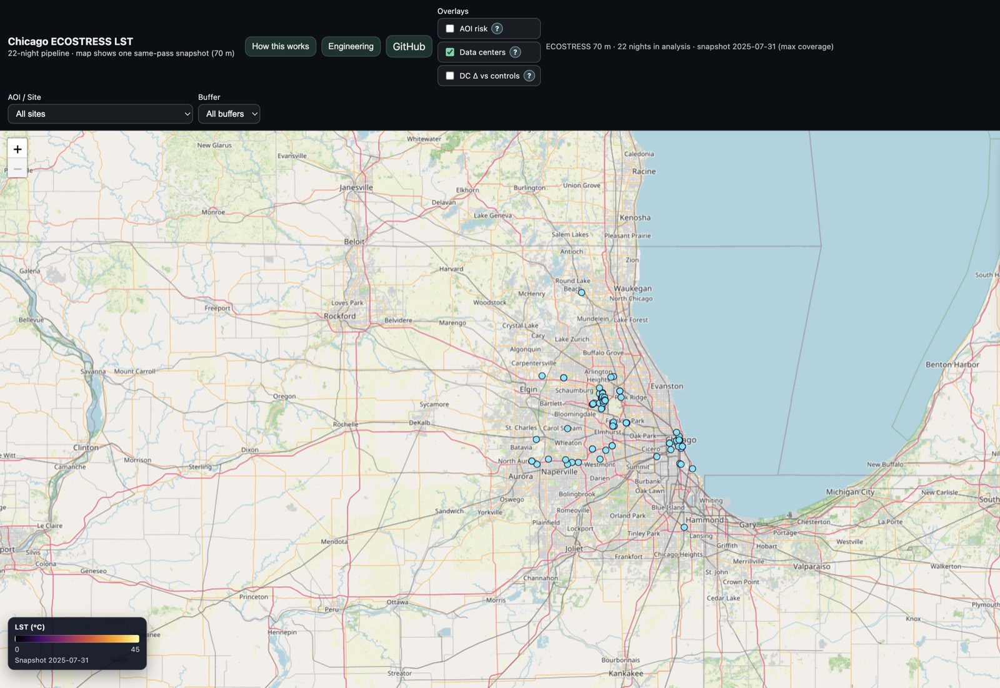
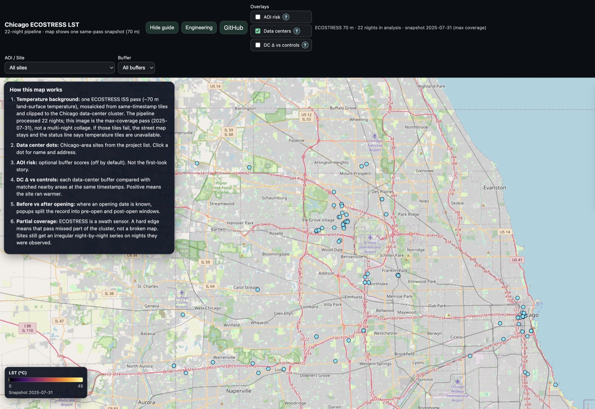

## Chicago DC Night Heat

**Question:** Are neighborhoods around Chicago data centers hotter at night than matched nearby areas?

**Built:** Python ECOSTRESS pipeline (QC, Kelvin→°C, zonal stats) → GeoJSON overlays → Leaflet demo. Optional COG tiles via static XYZ or TiTiler.

**Proof (observational):** Across 113 mapped sites in July 2025, 500 m data-center buffers averaged about **+2.4 °C** vs matched controls (median 10 nights per site). Not a causal claim.

**Stack:** Python, GeoPandas/rasterio, Leaflet, Docker/TiTiler, GitHub Actions, pytest.

**Live app:** `https://charlotteprevost.github.io/chicago_lst/frontend/` · guided tour: add `?tour=1`

The map background is one same-pass ECOSTRESS snapshot (2025-07-31, ~70 m) that covered all 113 geocoded sites from a 183-row DataCenterMap list. Site Δ overlays use the 22-night series.


## Portfolio quick view

### Screenshots




### 60-second demo

| Step | Time | Action | What to highlight |
|------|------|--------|-------------------|
| 1 | 5s | Open the [live map](https://charlotteprevost.github.io/chicago_lst/frontend/) | Title **Chicago DC Night Heat**; 183 listed / 113 mapped |
| 2 | 10s | Read the study blurb + Mean DC Δ | +2.4 °C at 500 m; observational |
| 3 | 15s | Default layers: sites + warmer-than-control | Click a polygon for Δ°C vs matched controls |
| 4 | 10s | Optional `?tour=1` | Zooms to Digital Realty Cermak |
| 5 | 10s | Advanced → Engineering | QC, CI, TiTiler health |

### Demo (local)

1. From the repo root: `python3 -m http.server 8080`
2. Open `http://localhost:8080/frontend/`
3. Pages deploy bakes static XYZ. Locally, TiTiler on Render may cold-start; a yellow banner says so if tiles fail. Overlays still load.

---

## 1) Purpose

**Study sites:** 183 Chicago-area data centers from DataCenterMap; 113 could be geocoded and are the locations on the map.

Default overlays:

- **Data center sites:** the study locations (not a generic heatmap).
- **Warmer than control (Δ°C):** each 500 m buffer vs matched non–data-center controls at the same timestamps.
- **Heat context score:** optional, off by default.

### How to read Δ

- Higher positive Δ: data-center areas were warmer than matched controls.
- Near zero: little difference.
- Negative: cooler than matched controls.

### What this app is not

- It does **not** prove causality.
- It is an observational geospatial comparison.
- Results depend on clouds, QC masks, and list completeness.

Full formulas: [`docs/METHODS.md`](docs/METHODS.md).

---

## 2) Developer guide

### Repo structure

- `frontend/`: static web app (Leaflet map UI)
- `data/`: small web-ready artifacts (`*.geojson`, metadata json)
- `analysis/`: data processing and geospatial/statistical pipeline
- `backend/`: TiTiler container for serving COG tiles

### Recommended hosting model

- **Frontend**: GitHub Pages (static)
- **Backend**: Render (TiTiler for COG tiles)

### Quick start (local analysis)

From `analysis/`:

```bash
python3 -m venv .venv              # create local virtual environment
source .venv/bin/activate          # activate the environment
pip install -r requirements.txt    # install analysis dependencies
```

To run Chicago ECOSTRESS study (fetch bbox defaults to the DC hull + 10 km):

```bash
python 23_run_il_ecostress_dc_study.py \
  --data_centers ../data/chicago_data_centers_183.geojson \
  --start 2025-07-01 \
  --end 2025-07-31 \
  --buffers_m 250,500,1000 \
  --outputs_dir outputs_ecostress_il_qc
# --data_centers: input data center points
# --start/--end: analysis date window (UTC)
# --buffers_m: buffer distances in meters
# --outputs_dir: folder for generated outputs
```

To build DC effect GeoJSON for the web map:

```bash
python 06_export_dc_effect_geojson.py \
  --config outputs_ecostress_il_qc/config.ecostress_il.generated.json \
  --out ../data/dc_effect_cumulative.geojson
# --config: generated pipeline config from the study run
# --out: GeoJSON consumed by the frontend effect overlay
```

### To publish to GitHub Pages

1. Set repository Pages source to **GitHub Actions**.
2. Push to `main`.
3. Workflow `.github/workflows/pages.yml` publishes `frontend/` and `data/`.
4. Public URL: `https://charlotteprevost.github.io/chicago_lst/frontend/`
   The Pages workflow also bakes a static XYZ PNG pyramid (z6–z10) from the public COG when GDAL/rasterio is available, so first paint does not wait on Render.

### To publish to Render (TiTiler)

1. Create Render service from this repo using `render.yaml`.
2. Use `backend/` as service root (`rootDir: backend` in `render.yaml`).
3. Health check path is `/`.
4. Put your service URL in `frontend/config.js` as `titilerBaseUrl`.

### To use high-res ECOSTRESS LST in the app:

1. Build a COG from raster(s) in `analysis/` (`24_make_ecostress_cog.py` or `25_publish_latest_ecostress_cog.py`).
2. Host COG at a public URL that supports byte-range requests.
3. Update `data/ecostress_highres_latest.json` with that COG URL and optional `scene_time`.
4. Prefer a static XYZ pyramid (`26_bake_ecostress_xyz.py`) so the map does not wait on TiTiler. GitHub Pages bakes z6–z10 on deploy. Locally:

```bash
python 26_bake_ecostress_xyz.py \
  --cog /vsicurl/https://pub-35e731c3513942bd8c03f959efee69d1.r2.dev/ecostress_il_lst_70m_latest.cog.tif \
  --out-dir ../data/tiles/ecostress \
  --min-zoom 6 \
  --max-zoom 10 \
  --public-tiles-url "../data/tiles/ecostress/{z}/{x}/{y}.png" \
  --scene-time 2025-07-31T18:05:13Z
# --cog: local path or /vsicurl/<https COG>
# --out-dir: XYZ root {z}/{x}/{y}.png (WebMercatorQuad, EPSG:3857)
# --public-tiles-url: template written into data/ecostress_highres_latest.json
```

5. If `tiles_url` is missing or the probe tile 404s, the app falls back to TiTiler (`/cog/...`). If that fails, the OSM basemap stays and the status line reports that temperature tiles are unavailable.

---

## 3) Methods

Formulas, QC, and caveats: **[`docs/METHODS.md`](docs/METHODS.md)**.

Optional modeling scripts (`analysis/36_*`, `40_*`) are research extras and are not required for the live demo.

